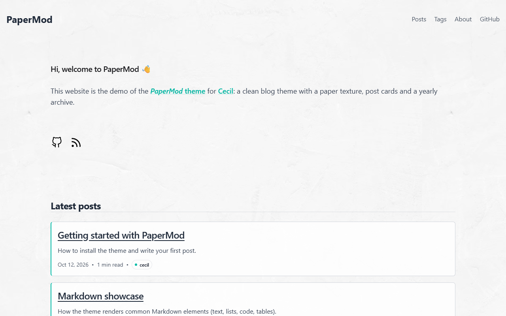
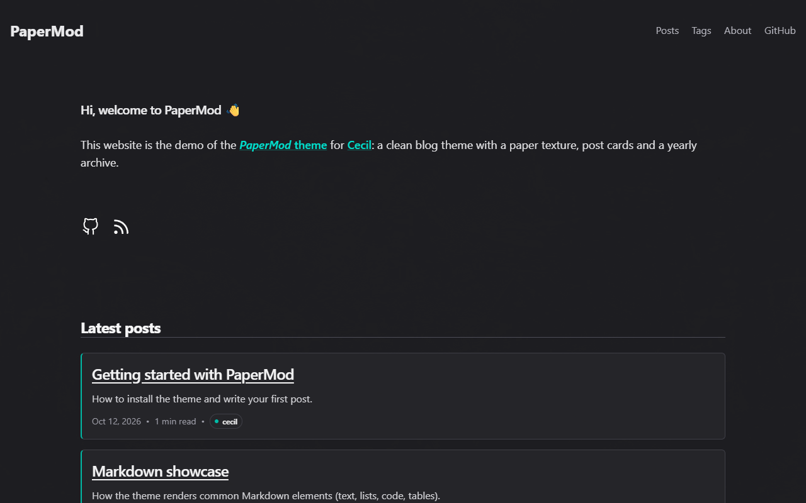

# PaperMod theme

The _PaperMod_ theme for [Cecil](https://cecil.app) is a clean and minimalist blog theme with a paper texture, inspired by [Hugo PaperMod](https://github.com/adityatelange/hugo-PaperMod) and built with [Tailwind CSS](https://tailwindcss.com) v4.

**[Demo](https://cecilapp.github.io/theme-papermod/)**

| Light                                           | Dark                                                |
|-------------------------------------------------|-----------------------------------------------------|
|  |  |

## Features

- Homepage with an introduction, social links and the latest posts
- Posts archive grouped by year and month, with Atom feed
- Post page with date, reading time and tags
- _About_ layout with a profile picture and links
- Tags (taxonomy) pages
- Light and dark color schemes, following the system preference
- Code syntax highlighting
- SEO and social metadata (built-in Cecil `metatags` partial)
- Translatable (English and French included)

## Installation

```bash
composer require cecil/theme-papermod
```

> Or [download the latest archive](https://github.com/Cecilapp/theme-papermod/releases/latest/) and uncompress its content in `themes/papermod`.

## Usage

Add `papermod` in the `theme` section of your `config.yml`:

```yaml
theme:
  - papermod
```

Write your posts in `pages/posts/`, prefixed by their date (e.g. `pages/posts/2026-10-12-my-first-post.md`).

The archive and the homepage display all the posts on a single page, so disable pagination in their front matter:

```yaml
# pages/index.md and pages/posts/index.md
---
pagination: false
---
```

### About page

Use the `about` layout:

```yaml
---
title: About
layout: about
page_title: About me # optional, title displayed in the page
image: images/about.jpg # optional, profile picture
---
```

### Links

Social links (displayed on the homepage and the about page) are defined in `data/links.yml`:

```yaml
- title: GitHub
  href: https://github.com/<user>
  picto: images/svg/github.svg # github, linkedin, feed and contact icons are included
```

### Configuration

Options with their default values:

```yaml
papermod:
  posts:
    section: posts # section containing the blog posts
    home: 5        # number of posts displayed on the homepage
  avatar: ''       # avatar displayed next to the site title (e.g. images/avatar.jpg)
  about:
    image: ''      # default profile picture of the about page
  licence: by-nc-sa # Creative Commons licence of the content (empty to hide)
  overlay: true    # paper texture overlay
  analytics: false # renders partials/analytics.html.twig
```

The footer displays `author.name` (or `title`).

If your posts are in another section than `posts` (e.g. `blog`), set `papermod.posts.section: blog` and map the section to the theme layouts:

```yaml
layouts:
  sections:
    blog: posts
pages:
  paths:
    - section: blog
      path: :section/:year/:month/:day-:slug
```

### Analytics

Set `papermod.analytics: true` and create your own `layouts/partials/analytics.html.twig` with your tracking code.

### Internationalization

Translations are provided in `translations/` (English and French).

## Development

The CSS (`assets/tailwind.css`, configured CSS-first, without `tailwind.config.js`) is compiled with the [Tailwind CSS](https://tailwindcss.com) v4 standalone binary through [tailwind-builder](https://github.com/ArnaudLigny/tailwind-builder) (no Node.js required):

```bash
composer install
composer css:build # or composer css:watch
```

Run the demo:

```bash
php demo/link.php
php cecil.phar serve demo
```

## License

_PaperMod_ is a free software distributed under the terms of the MIT license.
